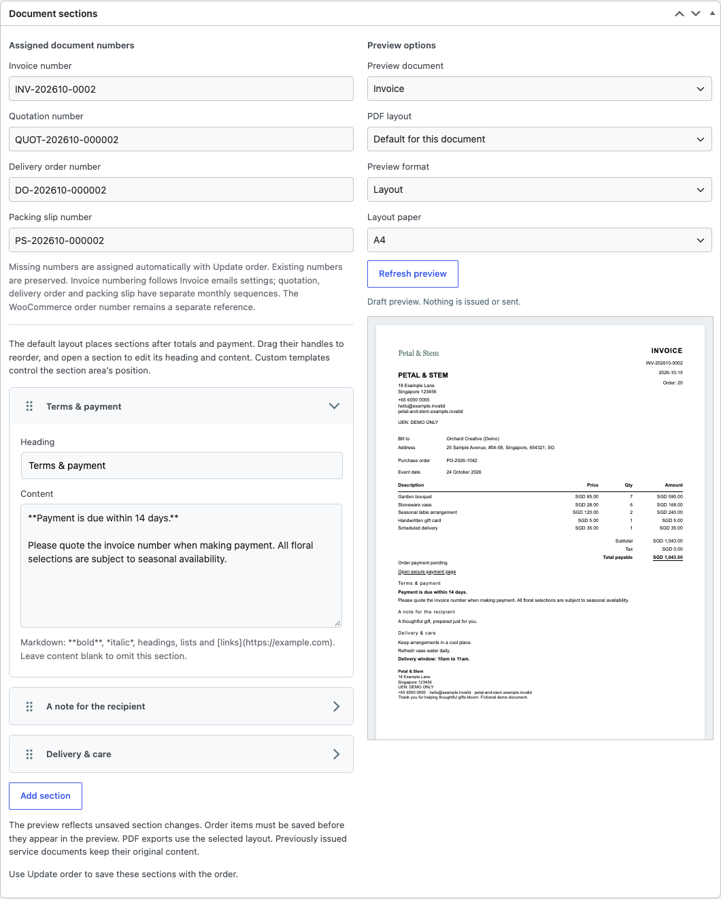
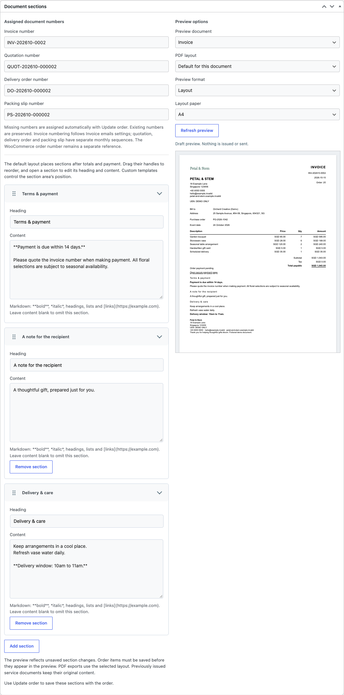
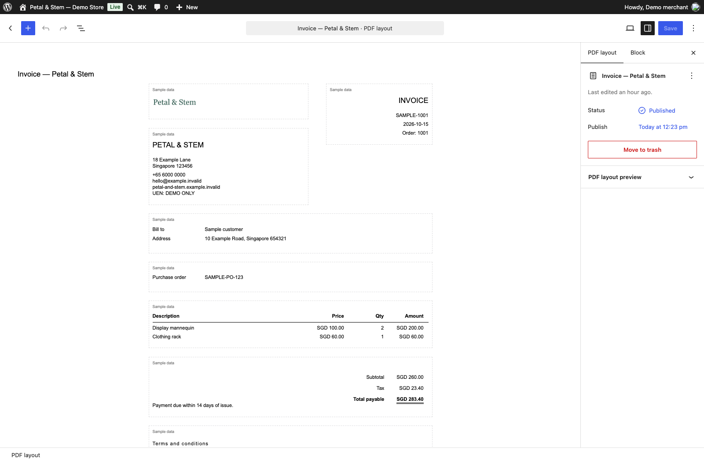
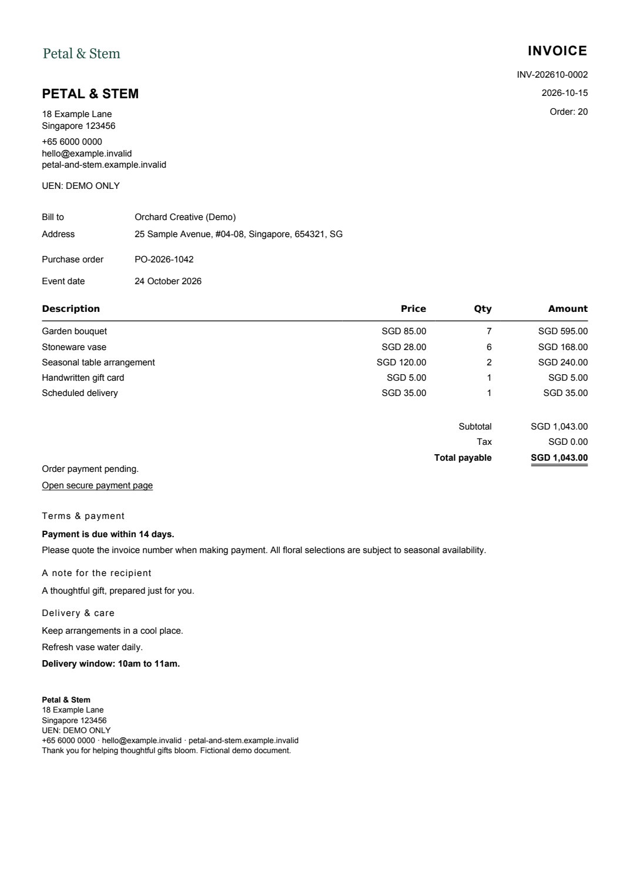
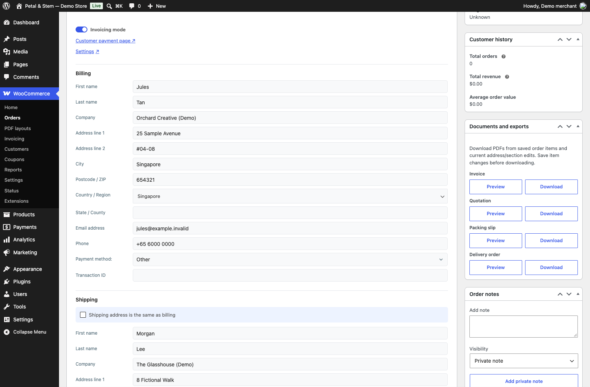

# Alkamy Order Editor Pro for WooCommerce

**Turn a WooCommerce order into a branded invoice, quotation, or delivery document.**

Keep editing the order where you work. Add customer references and terms, arrange document sections, and preview the PDF before downloading it. Pro adds an invoicing workspace and PDF layouts to [Alkamy Order Editor for WooCommerce](https://github.com/danielk-am/inline-order-editor-for-woocommerce).



## What you get

- **An invoicing workspace on the order.** Switch on Invoicing mode for stacked billing and shipping details, custom fields, and document sections. Add section headings and text, then drag sections into order.
- **Your own document design.** Set the logo, company details, paper size, line spacing, and footer. Arrange dynamic order blocks with supported WordPress blocks and reusable patterns. Assign different layouts to different document types.
- **A preview before export.** Preview and download invoices, quotations, packing slips, delivery orders, and credit notes for existing WooCommerce refunds. Packing slips and delivery orders show quantities without monetary values.
- **Your assigned document numbers.** Saving an order or its sections fills missing invoice, quotation, delivery-order, and packing-slip numbers. Each series is separate from the WooCommerce order reference. Opening a preview consumes no number.
- **One invoice for emails and downloads.** Enable automatic attachments for selected WooCommerce customer emails. The issued PDF and number are archived; resends and authorised customer downloads reuse that exact document.
- **Faster repeat business.** Save named terms, add fixed or percentage discounts, repeat an order at current catalogue prices, record offline payments, and turn one-off items into draft products.

## Free or Pro?

Pro is an add-on. The Free plugin supplies inline item entry and editing, and remains required.

| Your task | Free | Pro add-on |
| --- | --- | --- |
| Edit order item names, prices, quantities, and totals in place | Yes | Uses Free |
| Add catalogue products, one-off items, and delivery charges | Yes | Uses Free |
| Save order terms and show them in WooCommerce emails | Yes | Adds named terms presets |
| Add a discount, repeat an order, or save typed items as draft products | | Yes |
| Work in an invoicing workspace with custom fields and sections | | Yes |
| Design PDF layouts with blocks and reusable patterns | | Yes |
| Preview and download invoices, quotations, packing slips, delivery orders, and refund credit notes | | Yes |
| Attach archived invoices to selected customer emails | | Yes |

## Requirements and status

WordPress 6.8 or later, WooCommerce 10.0 or later, PHP 7.4 or later, and Alkamy Order Editor for WooCommerce 1.0.5-alpha or later are required. Use the current Free 1.0.10-alpha package with **Pro 1.3.6**.

Pro is free and open source under GPL-2.0-or-later. “Pro” means additional features, not a paid tier. No purchase, subscription or license key is required. Updates are manual ZIP uploads; no automatic update channel is configured. This is not an approved or published WooCommerce.com product. The invoicing workspace retains its documented alpha limitations. Test on a backup copy of your store first.

[Quality checks and compatibility coverage](docs/ci-quality.md) describe PHPUnit, Plugin Check, package, and browser checks. The prepared compatibility matrix is not a claim that every hosted CI job has run.

## Updates

Back up your store, download the newer Pro ZIP from the same official release source, and upload it through **Plugins > Add Plugin > Upload Plugin**. Confirm replacement of the existing plugin. Keep the Free dependency installed. Legacy saved license options are left untouched; this version does not read them or contact a licensing server.

## Install and create your first PDF

1. Install and activate WooCommerce and the Free plugin.
2. Upload the Pro ZIP under **Plugins > Add Plugin > Upload Plugin**, then activate it.
3. Open **WooCommerce > Invoicing > Document branding and PDF layouts**. Set your business details, choose a Media Library logo, and save the document design.
4. Open an order under **WooCommerce > Orders** and enable **Invoicing mode**. Edit the customer details, custom fields, and sections.
5. Save the order. Missing document numbers are assigned automatically. Existing assigned references are preserved.
6. In **Document exports**, use the document's **Preview** button, then **Download** when it is ready.

[The merchant guide](docs/user-guide.md) covers layouts, sections, email attachments, numbering, and the existing Pro order actions.

<details>
<summary>See sections, layouts, and PDF exports</summary>









</details>

## Payments and InvoiceNow

Continue using your existing WooCommerce payment gateways. Eligible unpaid invoices link to the WooCommerce customer payment page. Exporting a PDF does not charge a customer, record payment, create a refund, or send an email.

Custom fields have an optional **Send to payment provider** checkbox, off by default. Selected values are added through the official WooPayments and Stripe gateway metadata hooks when a payment is processed. Existing provider metadata stays intact. Values longer than 500 characters, or additions beyond 50 total entries, are skipped. Editing a paid order does not update its remote payment record.

The standard distribution includes optional disclosed WooPayments and HitPay referral links. The WooCommerce.com submission variant omits them. Customer UEN and Peppol ID fields can be recorded, but **InvoiceNow/Peppol transmission is not implemented**.

## Document and data limits

Local PDF rendering runs inside WordPress and needs no external payment or document-service connection. Supported templates accept bounded document blocks and local PNG/JPEG images, rather than arbitrary HTML, scripts, shortcodes, or remote resources. Preview every published layout with representative long orders.

PDFs support two-decimal currencies. Credit notes describe existing refunds; they do not initiate one. Save order changes before relying on a final export. Issued invoices keep their original bytes despite later order or layout edits. Back up the database, which contains the private invoice archive and number registry, as well as the site's files.

Line editing and discounts follow the Free plugin's editable-order protections. Percentage discounts are calculated when added and do not automatically change later. Repeating an order creates a new Pending payment order without payment details, coupons, fees, or discounts. Subscriptions, bookings, bundles, and external tax services need separate compatibility testing.

The optional legacy hosted service is a separate, administrator-configured path. It is outside this local-PDF offering; see [service privacy](docs/service-privacy.md) and [service terms](docs/service-terms.md) for its draft policy status.

## Development and checks

```sh
sh bin/build.sh --zip
php tests/package.php build/inline-order-editor-pro
```

The uploadable ZIP is `build/inline-order-editor-pro.zip`. See [quality workflow](docs/ci-quality.md) for PHPUnit, Plugin Check, package, and browser checks, and [invoice delivery operations](docs/invoice-delivery-1.3.md) for archive recovery and legacy import. [Demo guide](design/demo/README.md) documents the screenshots and recordings.

## Licence

GPL-2.0-or-later. See [LICENSE](LICENSE).

## Watch the walkthrough

[Watch the narrated Pro walkthrough](design/demo/videos/pro-walkthrough-narrated.mp4). It includes burned-in captions, with separate [WebVTT](design/demo/videos/pro-walkthrough-narrated.vtt), [SRT](design/demo/videos/pro-walkthrough-narrated.srt), and a [transcript](design/demo/videos/pro-walkthrough-transcript.md). Actual local demo, fictional records, and synthetic English narration.
